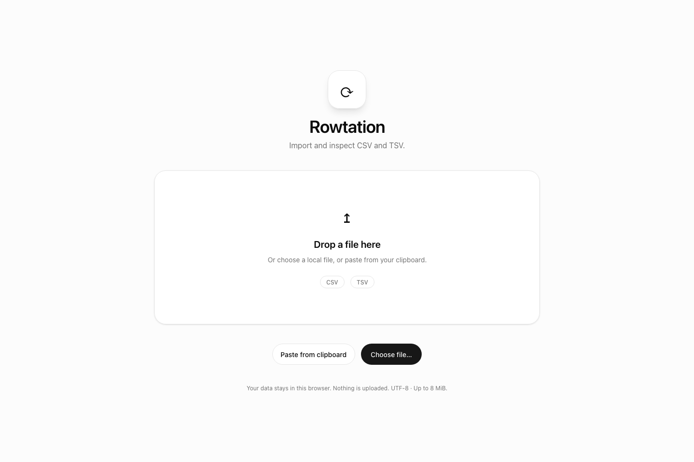
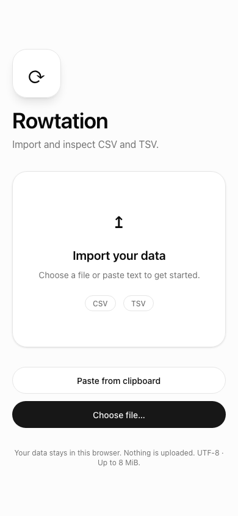
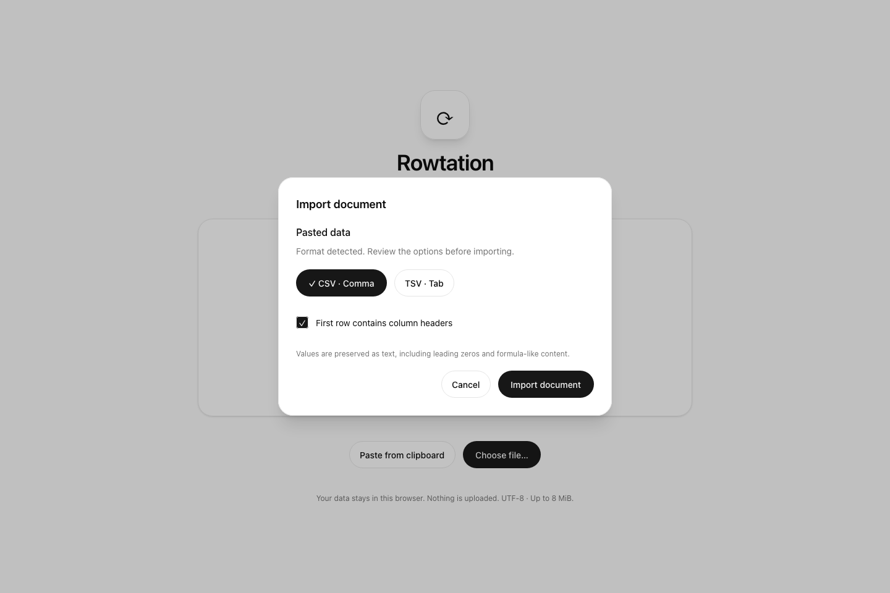
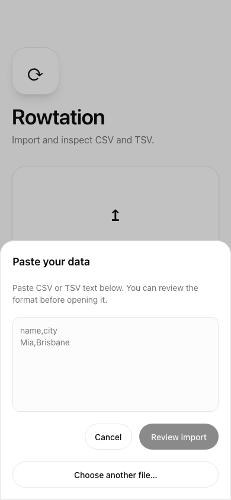
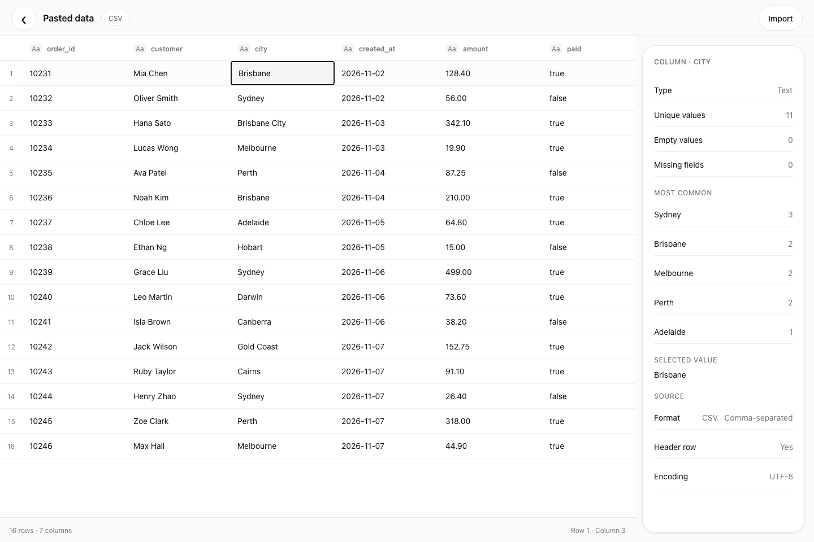
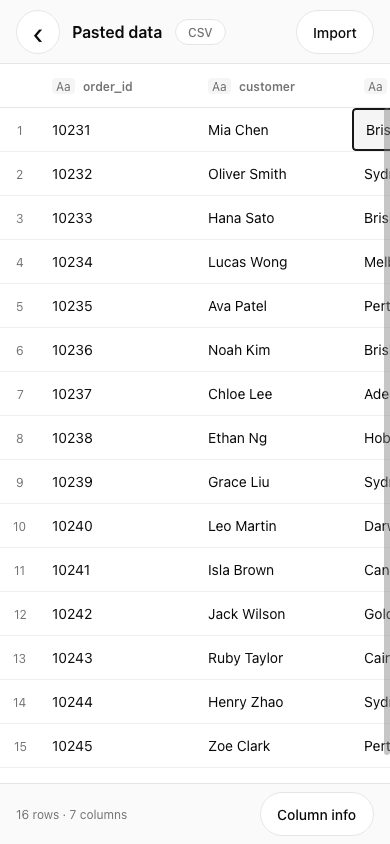
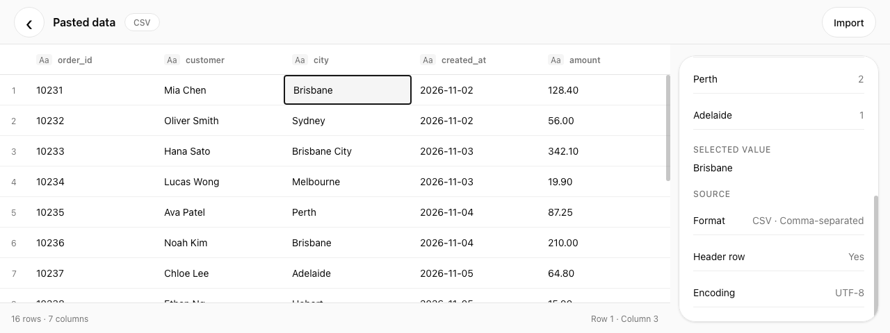
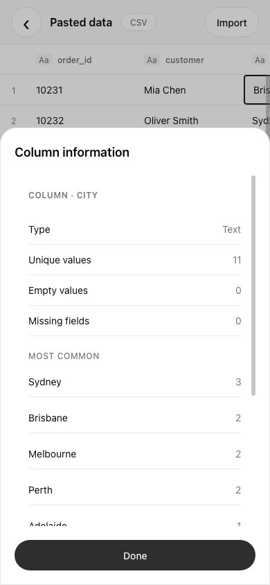
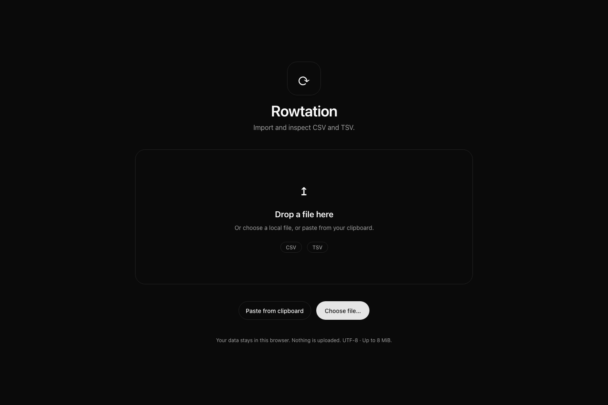

# Import and inspection validation

The captures use synthetic orders from tests/data/orders.csv, pasted into the real
production entry in Chromium. They contain no user documents. Regenerate them
with scripts/capture-layouts.sh; set ROWTATION_BROWSER when Chromium is outside
NSH's default search paths.

| Desktop | Mobile |
| --- | --- |
|  |  |
|  |  |
|  |  |
|  |  |

## Focused workflow checks

`nsh test` runs the Rust fixtures and production UI workflows. These cover UTF-8
CSV/TSV parsing, explicit headers, failed import preservation, successful
replacement, disposal, exact profile counts, bounded previews, cached summaries,
virtualized scrolling, keyboard selection and responsive layouts. The wide-table
case uses 512 columns and a 2160-point viewport so row-window requests must split
to stay under the Rust cell limit. That same case narrows the viewport and
navigates to an offscreen column. One mobile workflow covers TSV/no-header import and the contextual inspector. There
are six UI/bridge workflows in total; parser and statistics cases stay in Rust.
Appearance is verified through screenshots rather than a separate DOM geometry
test harness.

`nsh test --target web --browser <Chromium>` runs those UI workflows through actual
browser input and Rust/WASM, independently from the native headless checks.

`scripts/test-browser-files.sh` adds browser File/FileList/DragEvent coverage:
file picker selection, a valid TSV drop, malformed CSV, unsupported extension,
multiple-file rejection, preservation/replacement and closing/reopening a
session. It uses synthetic File objects to supply a picker selection instead
of driving the operating system's chooser. The fixture host supplies file
selections/drops only; it contains no layout observer or product test controls.
The script restores nsh.json after its temporary test-host configuration,
including on failure. Run NSH commands serially; 0.4's generated runtime paths
are shared with the development server and package builder.

## Verification result

Verified on 2026-11-07 with NSH 0.4.0 and installed Chromium:

- `cargo fmt --check`, `nsh check`, and `nsh build`: passed.
- `nsh test`: 29 passed (23 Rust tests and six UI/bridge workflows).
- `nsh test --target web --browser <Chromium>`: six workflows passed.
- `scripts/test-browser-files.sh`: local picker/drop workflow passed.
- Native and wasm32 `cargo clippy` with warnings denied: passed.
- `nsh package --target web -o dist`: passed.
- Visually inspected light desktop (1440×960), short desktop (1280×480), mobile
  (390×844), and dark desktop captures. Desktop dialogs are centered, the inspector
  frame stays fixed during scrolling, and its content remains clipped to the panel.

## Limits

CSV/TSV values remain literal Text. There is no numeric/date inference, automatic
header inference, history, persistence, search, sorting, editing, undo or export
UI. The existing internal serializer remains available to Rust callers.

Parsing and first-time column profiling are synchronous on the browser thread.
Existing resource caps remain in force: 8 MiB input, 100,000 rows, 512 columns and
1,000,000 stored fields. These are resource guards, not large-file responsiveness
benchmarks. The grid/inspector show bounded previews for long values; they are not
full-text editors. File selection/drop requires a modern browser. Clipboard
permission failures leave a manual paste field available.

The scoped duplicate-scrollbar CSS depends on NSH 0.4's browser DOM classes;
visually check horizontal scrolling when upgrading NSH. Web is the only deliverable.
